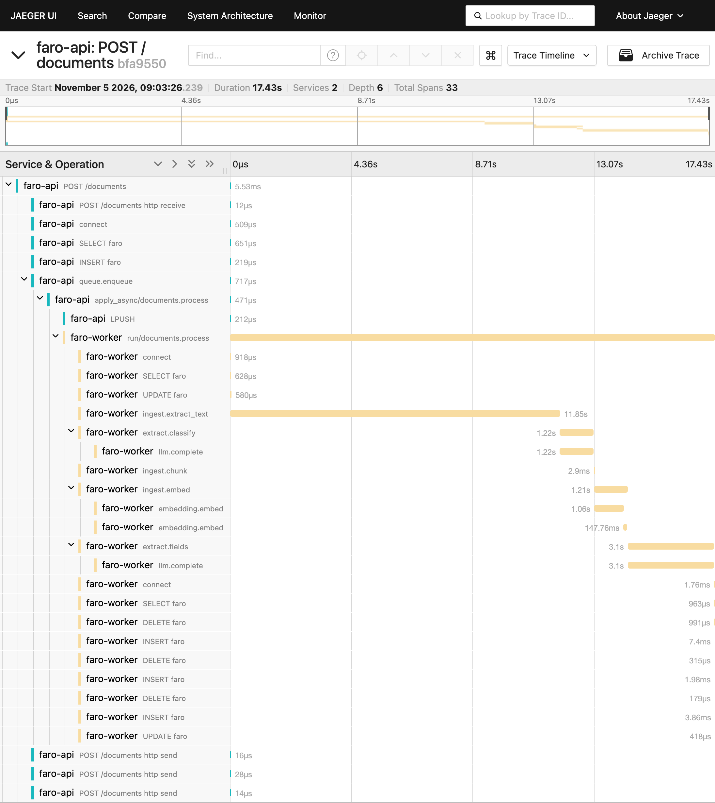
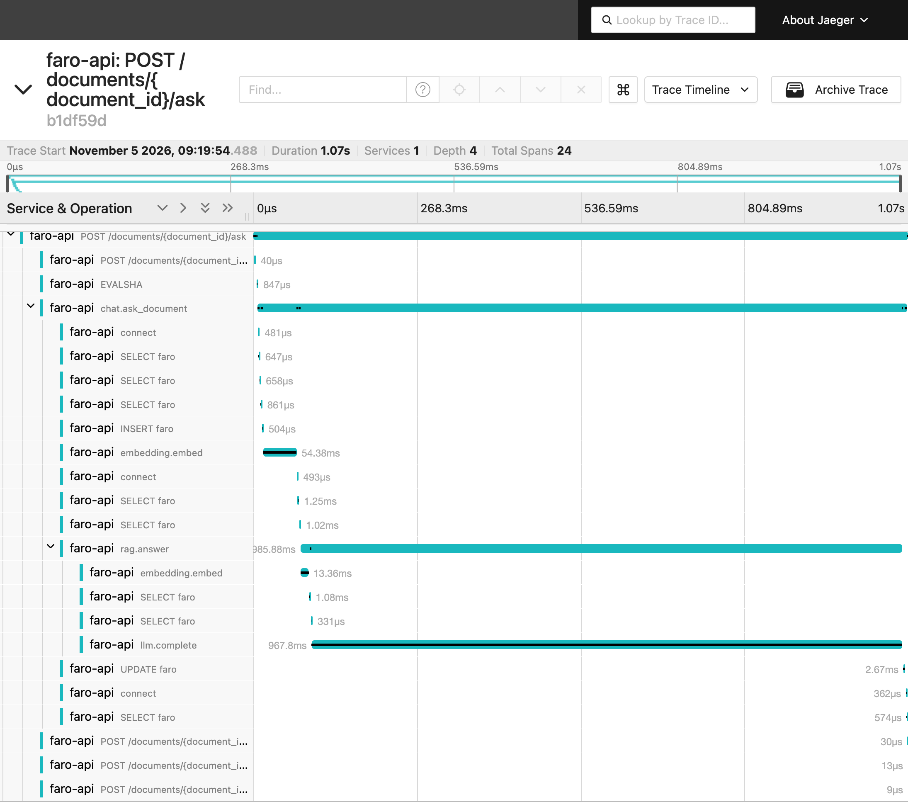

# faro-rag

RAG portal to query insurance policies and invoices for **Seguros Faro del Sur** (a fictitious insurer). It receives PDFs, processes them in the background (text, chunks, embeddings and structured fields) and answers natural-language questions citing document and page. The whole flow, from the HTTP request to the Celery task and the LLM call, is traced with OpenTelemetry.

**Stack:** FastAPI · Celery + Redis · PostgreSQL 16 + pgvector · Docling · LiteLLM (Gemini) · sentence-transformers · React + TypeScript + Vite · OpenTelemetry + Jaeger · Docker Compose.

The chat works in Spanish: documents, questions and answers are in Spanish.

## Table of contents

- [faro-rag](#faro-rag)
  - [Table of contents](#table-of-contents)
  - [1. Requirements](#1-requirements)
  - [2. Running](#2-running)
    - [Start](#start)
    - [Reload](#reload)
    - [Control](#control)
  - [3. Access points](#3-access-points)
  - [4. Architecture](#4-architecture)
  - [5. Flows](#5-flows)
    - [Processing a document](#processing-a-document)
    - [Question in the general chat (`POST /ask`)](#question-in-the-general-chat-post-ask)
    - [Question about one document (`POST /documents/{id}/ask`)](#question-about-one-document-post-documentsidask)
  - [6. Data model](#6-data-model)
  - [7. API](#7-api)
  - [8. Configuration](#8-configuration)
  - [9. Observability](#9-observability)
  - [10. Security](#10-security)
  - [11. Tests and CI](#11-tests-and-ci)
  - [12. Development](#12-development)
    - [Backend](#backend)
    - [Frontend](#frontend)
  - [13. Sample dataset and demo](#13-sample-dataset-and-demo)
  - [14. Sample traces](#14-sample-traces)
  - [15. What is done](#15-what-is-done)
  - [16. What is not done](#16-what-is-not-done)
  - [17. Known limitations](#17-known-limitations)
  - [18. Further documentation](#18-further-documentation)

## 1. Requirements

- Docker and Docker Compose. Everything runs in containers, locally too.
- For the demo (`samples/demo.sh`): `curl` and `jq`.
- To use a real LLM: an API key from a provider supported by LiteLLM. Without one, the fake provider (`LLM_PROVIDER=fake`) runs the whole application with no network and no cost.

## 2. Running

### Start

```bash
make up            # whole stack; frontend at http://localhost:3000
make dev           # everything with automatic reload (Compose Watch); frontend at http://localhost:5173
make up-backend    # backend only: api, worker, postgres, redis, migrations and tracing
```

Without `.env`, `.env.example` is used. To customize: `make env` and edit `.env`, which takes precedence. On first run, the API and the worker download the embedding model and Docling its layout models, into cache volumes.

### Reload

| Change | How it is applied |
|---|---|
| Code in `backend/app/` with `make dev` | Automatic: the API reloads (uvicorn, also for the `.txt` prompts) and the worker restarts (Celery does not reload code) |
| Code without `make dev` | `docker compose up -d --build api worker` |
| Dependencies (`pyproject.toml`, `uv.lock`) | `docker compose up -d --build api worker` (automatic with `make dev`) |
| `.env` variables | `docker compose up -d api worker` (recreates the containers) |
| New migration | `make migrate` |
| Frontend with `make dev` | Automatic (Vite) |

### Control

```bash
docker compose ps                       # service status
make logs                               # api and worker logs (JSON, with trace_id)
curl -s localhost:8000/health/ready     # database, Redis and worker
make shell                              # shell in an API container
make down                               # stop
make clean                              # stop and delete volumes (database, files, model caches)
make help                               # every command
```

## 3. Access points

| What | URL |
|---|---|
| Web interface | <http://localhost:3000> (`make up`) · <http://localhost:5173> (`make dev`) |
| API | <http://localhost:8000> |
| Interactive API documentation (Swagger) | <http://localhost:8000/docs> |
| Traces (Jaeger) | <http://localhost:16686> (services `faro-api` and `faro-worker`) |
| PostgreSQL | `localhost:5432` (`POSTGRES_HOST_PORT`), user, password and database `faro` |

The interface has three views, chosen in the sidebar:

- **Documents:** upload and list with their status (polling while they are processed) and the reason for failures.
- **Chat:** questions about every document or about one, with visible citations (document and page) and a separate block for "no evidence".
- **Fields:** fields extracted from a document with their confidence, status and page; failed ones are flagged. Fields and free data can be edited and deleted.

## 4. Architecture

```
                    ┌──────────────┐  /api (nginx or Vite proxy)
                    │ Frontend     │──────────────┐
                    │ React (SPA)  │              │
                    └──────────────┘              ▼
                                         ┌─────────────────┐   enqueues task   ┌──────────┐
   POST /documents  ───────────────────► │  FastAPI API    │ ────────────────► │  Redis   │
   GET  /documents[/id]                  │  - validation   │   (broker +       │ (broker, │
   PATCH/DELETE fields and data          │  - duplicate    │    rate limit)    │  rate    │
   POST /ask · /documents/{id}/ask       │    detection    │                   │  limit)  │
                                         │  - chat + RAG   │                   └────┬─────┘
                                         └───┬─────────┬───┘                        │ task
                                             │         │ LLM (answer and            │
                                 read/write  │         │ filters) · embeddings      ▼
                                             │         │                   ┌─────────────────┐
                                             │         └──────────────────►│ Celery worker   │
                                             ▼                    LiteLLM  │ Docling → LLM → │
                                   ┌───────────────────┐ ◄─────────────────│ chunks →        │
                                   │ PostgreSQL 16     │   single          │ embeddings →    │
                                   │ + pgvector        │   transaction     │ fields          │
                                   │ documents, chunks │   at the end      └─────────────────┘
                                   │ fields, conversat.│
                                   └───────────────────┘
   API and worker ── OTLP ──► OpenTelemetry Collector ──► Jaeger (UI :16686)
```

OTLP (*OpenTelemetry Protocol*) is the standard protocol used to send the traces to the Collector, which forwards them to Jaeger. The application does not depend on Jaeger: another backend only needs a change in the Collector configuration (`infra/otel/`).

| Service (Compose) | Image | Role |
|---|---|---|
| `api` | `backend/Dockerfile` (target `api`) | FastAPI: upload, queries, editing, chat and RAG |
| `worker` | `backend/Dockerfile` (target `worker`, with Docling) | Celery: document processing |
| `migrate` | target `api` | Alembic `upgrade head` before the api and the worker start |
| `postgres` | `pgvector/pgvector:pg16` | Data, vectors (HNSW) and full text (GIN) |
| `redis` | `redis:7-alpine` | Celery broker and rate-limit counters |
| `otel-collector` | `otel/opentelemetry-collector-contrib` | Receives OTLP and forwards to Jaeger |
| `jaeger` | `jaegertracing/all-in-one` | Trace storage and viewer |
| `web` / `web-dev` | `frontend/` | nginx with the SPA and the `/api` proxy / Vite with hot reload (`dev` profile) |
| `tests` | target `test` (`test` profile) | pytest and ruff over the mounted `backend/` |

Backend layers (`backend/app/`):

| Folder | Contents |
|---|---|
| `api/` | Routes, dependencies, mapping to schemas, request logging middleware |
| `services/` | Use cases: upload, processing, chat, editing of fields and data |
| `ai/ingestion/` | Docling, page counting (pypdfium2), chunking and detection of data in tables and lines |
| `ai/extraction/` | Classification and field extraction with the LLM, Pydantic validation and retries |
| `ai/query/` | Turning the question into filters: rules first, the LLM when needed |
| `ai/rag/` | Hybrid search, prompt building, answer and citation checks |
| `ai/providers/` | LLM and embedding interfaces: LiteLLM, sentence-transformers and fake providers |
| `ai/prompts/` | Every prompt, one `.txt` per message |
| `db/` | SQLAlchemy 2.0 models, repositories and session; migrations in `backend/alembic/` |
| `domain/` | Enums and DTOs shared across layers |
| `worker/` | Celery application and tasks |
| `core/` | Errors, JSON logging, telemetry and startup checks |

## 5. Flows

### Processing a document

1. **`POST /documents`** validates extension, MIME type, `%PDF-` signature and size (`MAX_UPLOAD_MB`). It computes the SHA-256: if the file already exists, it returns that document (`duplicate: true`) and, if it had failed, queues it again. Otherwise it stores the file named after its hash, creates the `pending` record, commits the transaction and enqueues the task. It answers `202` with the id.
2. **Worker** (`processing`): counts the pages with pypdfium2 (rejecting corrupt or encrypted files and those over `MAX_PAGES` without converting them) and extracts the text of each page with **Docling** (Markdown, with OCR), along with the **free data** of tables and "label: value" lines.
3. **Classification** with the LLM (whole PDF attached, or text with `LLM_DOCUMENT_INPUT=text`): policy, invoice or unknown. An unknown document stops here, `done`, without chunks or fields.
4. **Chunking**: running text by characters (1000 with an overlap of 150); tables by whole rows, repeating the header. Chunks never cross pages.
5. **Embeddings** of chunks and free data, in batches (`EMBEDDING_BATCH_SIZE`).
6. **Field extraction** with the LLM, validated field by field with Pydantic. An invalid answer is retried with the validation error (waits of 2 and 6 s, 3 attempts); after that, the field is `failed` with its error.
7. **Stored in a single transaction**: chunks, fields, free data and the switch to `done`. Reprocessing replaces everything, without duplicates.

**Failures.** Permanent ones are not retried and show their code in the API and the UI: `corrupt_pdf`, `no_extractable_text`, `too_many_pages`. Transient ones (provider or database) retry the task with exponential backoff (5 s up to 60 s, 3 times). Each LLM call has a timeout (`LLM_TIMEOUT_SECONDS`). *At-least-once* delivery (`acks_late`): if the worker dies, the task is queued again and, being idempotent, running it again duplicates nothing.

### Question in the general chat (`POST /ask`)

1. **Filters**: rules applied to the question (type, dates, amounts, values to include or exclude) and, when the rules are not enough, the LLM with the last 3 exchanges of the conversation. If the question only asks to list documents ("facturas de más de 1000 €"), the list is returned, without search or LLM answer.
2. **Hybrid search** over the filtered documents: vector (pgvector, cosine ≥ `RETRIEVAL_MIN_SIMILARITY`) and Spanish full text (every word), merged with Reciprocal Rank Fusion. Chunks and free data compete for the `RETRIEVAL_TOP_K` places.
3. **No evidence**: if nothing passes the threshold, the answer is "No hay información suficiente para responder." without calling the LLM.
4. **Answer**: the LLM receives the numbered sources (`<dato>` and `<fragmento>`) and may only use them. If one part of the question has no source, it says so in that part; if it cannot answer anything, it returns a fixed text.
5. **Checks**: an answer without valid citations is discarded, citations to non-existent sources are removed and the rest are renumbered in order of appearance. Each citation carries document, page and excerpt.
6. The question and the answer are stored in the conversation.

### Question about one document (`POST /documents/{id}/ask`)

No filters are interpreted. The LLM receives the fields extracted from the document, the `RETRIEVAL_FACTS_TOP_K` free data most related to the question and the chunks from the hybrid search, optionally limited to a page range. A document that is not `done` returns `409`.

## 6. Data model

| Table | Contents |
|---|---|
| `documents` | File (name, unique SHA-256, size, path), status, type, pages and error (`error_code`, `error_message`) |
| `chunks` | Text chunk with document, page, index, `embedding vector(384)` (HNSW) and Spanish `tsv` (GIN). Unique per document, page and index |
| `extracted_fields` | `(label, value)` pairs. `is_predefined = true`: fixed fields of the document type (`invoice_amount`, `policy_number`…), unique per document, with confidence, status (`ok`, `not_found`, `failed`, `edited`), original value and typed, indexed columns for the filters. `is_predefined = false`: free data from tables and lines, with page, position in the table and `embedding` |
| `conversations` | Chat conversation with its messages in JSONB (question, answer, citations, filters) |

## 7. API

| Method | Path | Description |
|---|---|---|
| `POST` | `/documents` | Uploads a PDF. `202` with the id; `200` + `duplicate: true` if it already existed; if it had failed, it is queued again (`202`) |
| `GET` | `/documents` | List with status (`pending`, `processing`, `done`, `failed`) and error |
| `GET` | `/documents/{id}` | Status, error, fixed fields (`fields`) and free data (`facts`) |
| `PATCH` | `/documents/{id}/fields/{name}` | Corrects or fills in a fixed field; validated like the LLM output and reindexed for the filters |
| `DELETE` | `/documents/{id}/fields/{name}` | Deletes a fixed field (except `document_type`) |
| `PATCH` | `/documents/{id}/facts/{fact_id}` | Corrects the label or the value of a free datum; keeps the original and recomputes its vector |
| `DELETE` | `/documents/{id}/facts/{fact_id}` | Deletes a free datum |
| `POST` | `/ask` | Question about every document, within a conversation (`conversation_id`); returns the answer, citations and applied filters, or the list of documents |
| `POST` | `/documents/{id}/ask` | Question about one document, optionally with `pages: {from, to}` |
| `GET` | `/conversations/{id}` | Conversation history |
| `GET` | `/health`, `/health/ready` | Process health; and database, Redis and worker health (`503` if something fails) |

Errors use the format `{"error": {"code", "message"}}`: `invalid_file_type` (415), `file_too_large` (413), `document_not_found` (404), `document_not_ready` (409), `document_not_queryable` (409), `invalid_field_value` (422), `rate_limited` (429), `provider_error` (502), `provider_timeout` (504)… Every endpoint is detailed at <http://localhost:8000/docs>.

```bash
curl -F "file=@factura.pdf;type=application/pdf" localhost:8000/documents
curl -s localhost:8000/documents/<id> | jq '.status, .fields'
curl -s localhost:8000/ask -H 'content-type: application/json' \
     -d '{"question": "¿Qué facturas superan los 1000 euros?"}'
curl -s localhost:8000/documents/<id>/ask -H 'content-type: application/json' \
     -d '{"question": "¿Cuál es el importe total de la factura?"}'
```

## 8. Configuration

Every variable is described in [`.env.example`](.env.example). The main ones:

| Variable | Default | Description |
|---|---|---|
| `LLM_PROVIDER` | `fake` | `fake` (no network, deterministic) or `litellm` |
| `LLM_MODEL`, `LLM_API_KEY` | `fake-llm`, empty | LiteLLM model with its provider prefix (e.g. `gemini/gemini-2.5-flash`) and its key |
| `LLM_DOCUMENT_INPUT` | `pdf` | What the LLM receives to classify and extract: `pdf` (attachment; the model must accept it) or `text` |
| `LLM_TIMEOUT_SECONDS`, `LLM_TEMPERATURE` | `20`, `0` | Timeout of each call and temperature |
| `EMBEDDING_PROVIDER`, `EMBEDDING_MODEL`, `EMBEDDING_DIM` | `sentence_transformers`, multilingual MiniLM, `384` | Provider, model and dimension (must match the column) |
| `CHUNK_SIZE`, `CHUNK_OVERLAP` | `1000`, `150` | Chunking of running text |
| `MAX_UPLOAD_MB`, `MAX_PAGES` | `20`, `200` | PDF limits |
| `RETRIEVAL_TOP_K`, `RETRIEVAL_MIN_SIMILARITY` | `6`, `0.35` | Sources per answer and similarity threshold |
| `RETRIEVAL_FACTS_TOP_K` | `15` | Free data in questions about one document |
| `ASK_RATE_LIMIT` | `10/minute` | Question limit per IP |
| `CHAT_CONTEXT_TURNS`, `TIMEZONE` | `3`, `America/Toronto` | Context used to interpret the question, and time zone for "hoy", "ayer"… |
| `WORKER_CONCURRENCY` | `2` | Documents the worker processes at the same time |
| `TASK_MAX_RETRIES`, `TASK_RETRY_BACKOFF_SECONDS` | `3`, `5` | Task retries |
| `LOG_LEVEL`, `OTEL_ENABLED` | `INFO`, `true` | Log level and trace export |

## 9. Observability

- **One trace per flow**, from the HTTP request: the Celery instrumentation propagates the context to the task, so the upload, the processing in the worker and the LLM calls form a single trace. FastAPI, SQLAlchemy and Redis are instrumented too.
- **Custom spans**: `queue.enqueue`, `ingest.extract_text`, `extract.classify`, `ingest.chunk`, `ingest.embed`, `extract.fields`, `chat.ask_document`, `rag.answer`, `llm.complete`, `embedding.embed`, `fields.edit`, `facts.edit`…
- **Attributes**: `document.id`, `document.type`, `pdf.pages`, `chunks.count`, `fields.count`, `rag.fragments`, `rag.facts`, `rag.citations`, `rag.answered`, `llm.purpose`, `llm.latency_ms`, `gen_ai.usage.input_tokens`, `gen_ai.usage.output_tokens`, `gen_ai.request.model`… Traces store no document text, questions or keys.
- **Logs** in JSON, one line per step, with `trace_id` and `span_id`. `INFO`: ids, counters and durations; `DEBUG`: also the content (questions, text, LLM answers). Never PDF bytes or keys.
- **Viewer**: Jaeger at <http://localhost:16686>. Exported examples in [`trace-samples/`](#14-sample-traces).

## 10. Security

- **Upload**: extension, MIME type, `%PDF-` signature and size. The file is stored named after its hash, never after the user's file name.
- **Secrets**: none in the repository. `.env` is ignored by git and only `.env.example` is versioned, with empty keys.
- **Rate limit** on `/ask` and `/documents/{id}/ask` (`slowapi`, counters in Redis, per IP).
- **Prompt injection from the PDFs**:
  - the content goes between tags (`<documento>`, `<fragmento>`, `<dato>`), and any such tag inside the content is neutralized so it cannot close them;
  - the system prompt orders the model to treat it as data only and ignore its instructions;
  - the extraction output is validated with Pydantic;
  - answers may only cite sources that were actually sent.

  The LLM has no tools and no access to anything but that text: the worst possible outcome is a wrong answer.

## 11. Tests and CI

```bash
make test         # backend: unit + integration (real PostgreSQL and Redis from Compose, fake LLM)
make test-unit    # backend: unit only
make lint         # backend: ruff (lint and format)
make test-web     # frontend: Vitest + Testing Library + MSW
make lint-web     # frontend: tsc, ESLint and Prettier
```

- **Backend**: unit tests (chunking, data detection, Pydantic validation, prompts, filter rules, search and citation checks) and integration tests of the API and the Celery task against the `faro_test` database. No test calls a real LLM.
- **Frontend**: components and pages with a mocked API (MSW).
- **CI** (`.github/workflows/ci.yml`, on `push` to `main` and `development` and on every PR), two jobs in parallel:
  - **Backend**: builds the test image and, with the same Compose `tests` service as `make test` (PostgreSQL with pgvector, Redis, fake providers), runs `ruff check`, `ruff format --check` and `pytest` (unit and integration).
  - **Frontend**: types, lint, format, tests and build.

## 12. Development

### Backend

```bash
docker compose --profile test run --rm tests pytest tests/unit/test_chunker.py -v   # one file; -k <name> for one test, -s to see output
make format       # ruff format and safe lint fixes
make lock         # regenerate backend/uv.lock after changing pyproject.toml
```

- Integration tests share the `faro_test` database: do not run two test runs at the same time.
- The `tests` service mounts `backend/`, so it always tests the current code without rebuilding; the image is rebuilt only when dependencies change.
- Optional local environment for the editor (autocompletion, ruff and unit tests without Docker). Everything stays in `backend/.tools/` and `backend/.venv/`, ignored by git and outside the images:

  ```bash
  cd backend && mkdir -p .tools/bin
  curl -LsSf https://astral.sh/uv/0.5.11/install.sh | env UV_INSTALL_DIR=.tools/bin UV_NO_MODIFY_PATH=1 sh
  export UV_PYTHON_INSTALL_DIR=$PWD/.tools/python UV_CACHE_DIR=$PWD/.tools/cache
  .tools/bin/uv python install 3.12
  .tools/bin/uv sync --frozen               # dependencies + dev group, without PyTorch or Docling
  source .venv/bin/activate && pytest tests/unit -q
  ```

  Interpreter for VS Code: `backend/.venv/bin/python`. To remove it: `rm -rf backend/.venv backend/.tools`.

### Frontend

```bash
make format-web   # Prettier and safe ESLint fixes
make lock-web     # regenerate frontend/package-lock.json after changing package.json
```

| Folder (`frontend/src/`) | Contents |
|---|---|
| `api/` | HTTP client, endpoints and `types/` (one type per file, mirroring the Pydantic schemas) |
| `hooks/` | Data hooks with TanStack Query (documents, upload, field editing, health) and `useChat` |
| `context/` | Chat state, kept when switching views |
| `lib/` | Pure, testable logic: polling rule, Spanish error messages, PDF validation, value formatting, labels |
| `components/`, `pages/` | UI components (CSS Modules) and the three views |
| `styles/` | Palette tokens and status tones |
| `test/`, `__tests__/` | Test utilities (MSW server, fixtures, render with providers) and tests |

- The SPA always calls `/api/...` on its own origin: the Vite proxy forwards it in development and nginx in production, so there is no CORS and no API URL in the code.
- Polling: `GET /documents` repeats every 3 s only while a document is `pending` or `processing`, and stops when every document is `done` or `failed`. The fields view applies the same rule to `GET /documents/{id}` (`lib/polling.ts`, TanStack Query `refetchInterval`).

## 13. Sample dataset and demo

`samples/` holds 5 fictitious PDFs, 27 questions with their expected answer and a script that runs them against the API.

| File | Contents |
|---|---|
| `samples/pdfs/factura_electronica.pdf` | Vehicle sale invoice (4 pages): tables on page 1 and running text on pages 2-4 |
| `samples/pdfs/factura_taller.pdf` | Garage invoice (2 pages): fields and tables only |
| `samples/pdfs/poliza_condiciones_generales.pdf` | Car insurance policy (10 pages): basic data and general conditions |
| `samples/pdfs/anexo_extenso.pdf` | 231 pages: ends up `failed` (`too_many_pages`) |
| `samples/pdfs/doc_corrupto.pdf` | Starts with `%PDF-` but is damaged: ends up `failed` (`corrupt_pdf`) |
| `samples/questions.json` | Questions with their document (`document`), expected answer, whether they can be answered (`answerable`) and pages (`sources`) |

```bash
samples/demo.sh                 # uploads the PDFs, waits for them to be processed and asks the 27 questions
samples/demo.sh --only q1,q25   # only some questions
```

The upload is idempotent (a PDF already uploaded returns its id), so the demo can be repeated. Each question is asked to its document with `POST /documents/{id}/ask`, 7 s apart because of the rate limit. Variables: `API_URL`, `ASK_PAUSE`, `WAIT_TIMEOUT` and `SETTLE_SECONDS`.

**Regenerate the dataset** with `samples/generate_samples.py` (writes into `samples/pdfs/lote/` and checks each answer against the PDF text):

```bash
docker run --rm -v "$PWD":/work -w /work python:3.12-slim sh -c '
  apt-get update -qq && apt-get install -y -qq fonts-dejavu-core >/dev/null &&
  pip install -q reportlab pillow pypdf &&
  python samples/generate_samples.py --seed 2026'
```

Without `--seed`, each run generates different data. The included batch was generated without a seed, so it cannot be reproduced exactly; `doc_corrupto.pdf` was created separately.

## 14. Sample traces

`trace-samples/` holds traces exported from Jaeger during the demo.

**Processing `factura_electronica.pdf`**: a single 17.4 s trace that crosses the API (`POST /documents`, `queue.enqueue`: 5 ms) and the worker (`run/documents.process`): Docling 11.8 s, LLM classification 1.2 s, chunking and embeddings 1.2 s, LLM field extraction 3.1 s.



**Question about one document** ("¿Cuál es el importe total de la factura?"): 1.07 s; `rag.answer` with 4 chunks and 20 data as sources and 1 citation; `llm.complete` 968 ms, 2,498 input tokens and 23 output tokens.



| File | Contents |
|---|---|
| `ingest_factura_electronica.json` | Trace of the first screenshot |
| `ask_factura_electronica_importe.json` | Trace of the second screenshot |
| `ingest_doc_corrupto.json` | Damaged PDF: `ingest.extract_text` ends with `CorruptPdfError` in 63 ms, without calling the LLM |

To open them without the stack: Jaeger → *Search* → **JSON File** tab. To export another one: `curl -s localhost:16686/api/traces/<trace_id> | jq . > trace.json`.

## 15. What is done

- Upload with validation, duplicate detection by content (SHA-256) and asynchronous processing with Celery and Redis, with visible statuses (`pending`, `processing`, `done`, `failed`) and coded errors.
- Per-page text extraction with Docling, chunking with metadata (document, page), embeddings in pgvector and reprocessing without duplicates.
- Document classification and field extraction with the LLM validated with Pydantic, with bounded retries and an explicit error per field. Detection of free data in tables and "label: value" lines.
- Editing and deletion of fields and free data by the user, keeping the original value.
- Chat with hybrid RAG, document and page citations, partial answers, "no evidence" without making things up, natural-language filters, conversations and questions about one document.
- LLM and embedding providers swappable by configuration (LiteLLM, sentence-transformers) and deterministic fake providers.
- React interface with the three views: documents, chat and fields.
- End-to-end tracing with OpenTelemetry and Jaeger, JSON logs correlated by `trace_id`.
- Security: file validation, rate limit, no secrets in the repository and prompt injection mitigation.
- Backend (unit and integration) and frontend tests; linter and formatter configured; CI running both.
- Sample dataset, demo script and sample traces.

## 16. What is not done

- Analyzing why three demo questions (q13, q21 and q24) do not find a value that is in the document.

## 17. Known limitations

- No authentication.
- Docling takes from seconds to tens of seconds per document on CPU, and the first document downloads its models. A PDF with no text, not even with OCR, fails with `no_extractable_text`.
- With `LLM_DOCUMENT_INPUT=pdf`, the model must accept PDF input.
- If the process dies right between storing the document and enqueuing the task, the document may stay `pending` (there is no *outbox* pattern).
- Reprocessing a document replaces its fields and data: the user's edits and deletions are lost.
- Documents of unknown type are stored but not used in the chat.
- Switching to an embedding model with another dimension requires recreating the vector columns and reprocessing.

## 18. Further documentation

- [`DECISIONS.md`](DECISIONS.md): decisions, discarded alternatives and trade-offs (chunking and retrieval, idempotency, low-confidence fields, prompts, failures, security, use of generative AI).
